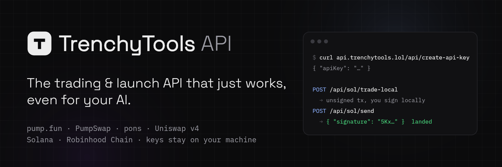

<p align="center"></p>

<p align="center"><a href="https://trenchy.tools/docs">Docs</a> · <a href="https://api.trenchy.tools/api/create-api-key">Get an API key</a> · <a href="https://api.trenchy.tools/AGENTS.md">AGENTS.md</a> · <a href="https://api.trenchy.tools/openapi.json">OpenAPI</a> · <a href="https://trenchy.tools/status">Status</a> · <a href="https://t.me/trenchytools"> Telegram</a> · <a href="https://x.com/trenchytools"> X</a></p>

**TrenchyTools** is a trading and launch API for pump.fun, PumpSwap and pons. One API key replaces the RPC node, the Jito client and the IPFS keys: the API builds unsigned transactions, your code signs them locally, the API sends them.

### Community

<p><a href="https://t.me/trenchytools"> <b>Telegram channel</b></a> — announcements, new starters, uptime<br>
<a href="https://t.me/dogtoshi_x"> <b>Dev / support</b></a> — questions, bugs, feature asks<br>
<a href="https://x.com/dogtoshi_x"> <b>X</b></a> — @dogtoshi_x</p>


### Starters

| Repo | What it is | Live demo |
|---|---|---|
| [**trenchytools-pumpfun-launcher**](https://github.com/Trenchy-Tools/trenchytools-pumpfun-launcher) | Launch on pump.fun, StonkFun or LetsBonk. Jito-bundled pump.fun launches with up to 16 buyers, snipers, holder auto-buys, custom pairs, Mayhem mode, timed sells, vanity mints. Solana. | [pumpfun.trenchy.tools](https://pumpfun.trenchy.tools) |
| [**trenchytools-pons-launcher**](https://github.com/Trenchy-Tools/trenchytools-pons-launcher) | Launch on pons, pools.trade, circus, Sushi or pools.fun and trade on the curve and Uniswap v4: bundled and later buyers, volume maker, auto-sell, live P/L. Robinhood Chain. | [pons.trenchy.tools](https://pons.trenchy.tools) |
| [**trenchytools-bnb-launcher**](https://github.com/Trenchy-Tools/trenchytools-bnb-launcher) | Launch tax tokens on Flap, trade any Flap, four.meme or PancakeSwap coin. BNB Chain. | [bnb.trenchy.tools](https://bnb.trenchy.tools) |
| [**trenchytools-base-launcher**](https://github.com/Trenchy-Tools/trenchytools-base-launcher) | Launch on Clanker V5 and trade on Uniswap v4. Base. | [base.trenchy.tools](https://base.trenchy.tools) |
| [**trenchytools-eth-launcher**](https://github.com/Trenchy-Tools/trenchytools-eth-launcher) | Launch on Sender or Stockereum (pair with WETH, USDC or tokenized stocks) and trade on Uniswap. Ethereum. | [eth.trenchy.tools](https://eth.trenchy.tools) |
| [**trenchytools-arc-launcher**](https://github.com/Trenchy-Tools/trenchytools-arc-launcher) | Launch on Tolly, Argus or pools.trade, USDC as gas. Arc. | [arc.trenchy.tools](https://arc.trenchy.tools) |
| [**trenchytools-wallet-mover**](https://github.com/Trenchy-Tools/trenchytools-wallet-mover) | Create wallets, split, distribute and consolidate funds, direct or through an exchange, same chain or cross-chain. | [mover.trenchy.tools](https://mover.trenchy.tools) |
| **trenchytools-elysium-launcher** 🔒 | Elysium (Hyperliquid L2) launcher. Private for now: if you are interested, DM [@dogtoshi_x](https://t.me/dogtoshi_x) on Telegram. | [elysium.trenchy.tools](https://elysium.trenchy.tools) |

They all share one wallet folder, so a wallet made in one is usable in the others. Try each one in the browser first (your wallets stay in your browser; download the backup before funding), or clone it, paste your key and `npm run dev`.

### 30-second start

```bash
curl "https://api.trenchy.tools/api/create-api-key"
```

```bash
curl -X POST "https://api.trenchy.tools/api/sol/trade-local?api-key=YOUR_KEY" \
  -H "content-type: application/json" \
  -d '{"publicKey":"YOUR_WALLET","action":"buy","mint":"COIN_MINT","amount":0.01,"denominatedInSol":"true","slippage":10}'
```

The answer is an unsigned transaction. Sign it with your wallet and send it with `POST /api/sol/send`.

### Build with AI

Paste into your coding agent:

> Read https://api.trenchy.tools/AGENTS.md and https://api.trenchy.tools/openapi.json, then build me a pump.fun bot that buys a coin when it launches and sells half at 2x. Save every wallet you create to a file before funding it.

### What the API covers

- **Solana**: pump.fun create, buy and sell, including custom pairs (coins priced in stocks, USDC or other coins) and Mayhem mode; PumpSwap after graduation; Jito bundles; vanity mints; creator fees; live websocket.
- **Robinhood Chain**: pons create, buy and sell on the curve and on Uniswap v4; live trades.
- **Elysium** *(experimental, pre-public-mainnet)*: Ascend launches on the Hyperliquid L2 (chain 99901, HYPE gas) — create, buy, sell, creator-fee claims, a per-wallet trading desk, and a live relay picker.
- **Wallets**: direct or exchange-routed transfers, same chain or cross-chain, with live venue health.
