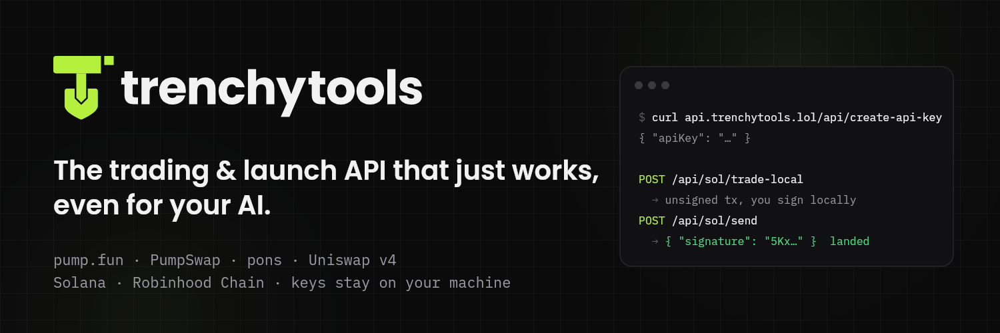

<p align="center"></p>

<p align="center"><a href="https://trenchytools-docs-production.up.railway.app/docs">Docs</a> · <a href="https://api.trenchytools.lol/api/create-api-key">Get an API key</a> · <a href="https://api.trenchytools.lol/AGENTS.md">AGENTS.md</a> · <a href="https://api.trenchytools.lol/openapi.json">OpenAPI</a> · <a href="https://trenchytools-docs-production.up.railway.app/status">Status</a> · <a href="https://t.me/trenchytools">Telegram</a> · <a href="https://x.com/trenchytoolz">X</a></p>

**trenchytools** is a trading and launch API for pump.fun, PumpSwap and pons. One API key replaces the RPC node, the Jito client and the IPFS keys: the API builds unsigned transactions, your code signs them locally, the API sends them. Keys never leave your machine.

### Starters

| Repo | What it is |
|---|---|
| [**pumpfun-starter**](https://github.com/Trenchy-Tools/pumpfun-starter) | Wallets, Jito-bundled launches with up to 16 buyers, snipers, holder auto-buys, custom pairs, Mayhem mode, trading with timed sells, vanity mints. Solana. |
| [**pons-starter**](https://github.com/Trenchy-Tools/pons-starter) | Launch and trade on pons, curve and Uniswap v4. Robinhood Chain. |
| [**wallet-mover**](https://github.com/Trenchy-Tools/wallet-mover) | Create wallets, split, distribute and consolidate funds, direct or through an exchange, same chain or cross-chain. |

All three share one wallet folder, so a wallet made in one is usable in the others. Each is one Next.js app: clone, paste your key, `npm run dev`.

### 30-second start

```bash
curl "https://api.trenchytools.lol/api/create-api-key"
```

```bash
curl -X POST "https://api.trenchytools.lol/api/sol/trade-local?api-key=YOUR_KEY" \
  -H "content-type: application/json" \
  -d '{"publicKey":"YOUR_WALLET","action":"buy","mint":"COIN_MINT","amount":0.01,"denominatedInSol":"true","slippage":10}'
```

The answer is an unsigned transaction. Sign it with your wallet and send it with `POST /api/sol/send`.

### Build with AI

Paste into your coding agent:

> Read https://api.trenchytools.lol/AGENTS.md and https://api.trenchytools.lol/openapi.json, then build me a pump.fun bot that buys a coin when it launches and sells half at 2x. Save every wallet you create to a file before funding it.

### What the API covers

- **Solana**: pump.fun create, buy and sell, including custom pairs (coins priced in stocks, USDC or other coins) and Mayhem mode; PumpSwap after graduation; Jito bundles; vanity mints; creator fees; live websocket.
- **Robinhood Chain**: pons create, buy and sell on the curve and on Uniswap v4; live trades.
- **Wallets**: direct or exchange-routed transfers, same chain or cross-chain, with live venue health.
